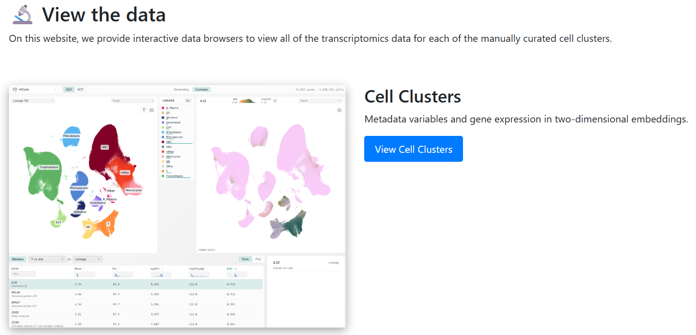

# PregnancyComplications

Welcome! Here we present our study of placental complications in pregnancy. The data include n=68 placental samples from 8 patient cohorts: term labored controls, term unlabored controls, preterm birth controls, spontaneous preterm birth (sPTB), fetal growth restriction (FGR), type 1 diabetes (DM1), term preeclampsia (PE) and preterm PE.

## Read the paper 🎓

Our manuscript is currently **under review**. The preprint is available on medRxiv:

* [medRxiv preprint (doi:10.64898/2026.08.16.26360516)](https://www.medrxiv.org/content/10.64898/2026.08.16.26360516v1)

<!-- TODO: add full citation (authors, title, journal) and BibTeX once the paper is published -->

## Explore the data 🔬

Explore 1.2M placental cells from 68 patients in an [interactive cell browser](https://villani.mgh.harvard.edu/EdlowLabPlacenta/). The patients span 8 cohorts: term labored, term unlabored and preterm birth controls, spontaneous preterm birth, fetal growth restriction, type 1 diabetes, term preeclampsia and preterm preeclampsia. View UMAP embeddings of all cells from all patients, plus sub-clusterings of 13 cell lineages with cell subset annotations. Look up the expression of any gene or surface protein on any UMAP and browse differentially expressed genes (DEGs) between cell subsets.

<a href="https://villani.mgh.harvard.edu/EdlowLabPlacenta/"></a>

## Download the data 💾

Raw counts and processed data objects are available at NCBI GEO, accession [GSE349211](https://www.ncbi.nlm.nih.gov/geo/query/acc.cgi?acc=GSE349211).

## Read the source code 💻

This repository contains the code used to generate the figures of the paper, split by language:

| Folder | Content |
|---|---|
| [`Python/`](Python) | Python scripts and notebooks for figures and tables, plus helper functions, auxiliary files and environments |
| [`R/`](R) | R scripts for figures and tables, plus helper functions and auxiliary files |

### Python

| Folder / file | Content |
|---|---|
| `Figure_*.py`, `Figure_*.ipynb` | Main figure panels, named by figure/panel |
| `SuppFig_*.py`, `SuppFig_*.ipynb` | Supplementary figures |
| `SuppTable_*.ipynb` | Supplementary tables |
| `Functions/` | Helper functions imported by the figure code |
| `AuxFiles/` | Auxiliary input files (marker gene lists, condition lists, thresholds, ...) |
| `environments/` | Package lists of the environments used |

Figure and table numbers follow the numbering in the paper.

### R

| Folder / file | Content |
|---|---|
| `Figure_*.R` | Main figure panels, named by figure/panel |
| `SuppFig_*.R` | Supplementary figures |
| `Functions/` | Helper functions sourced by the figure code |
| `AUX_files/` | Auxiliary input files (IPA results, DE/DA statistics, pathway annotations) |

### How to run

Every Python script/notebook begins with

```python
code_dir="/projects/Pregnancy_placenta/Code_Publication/Python/"
```

Change this single variable to the location of the `Python/` folder (keep the trailing `/`). Data and output paths are not yet parameterised.

### Environments

The analyses were run in different environments, so each notebook/script should be run in the matching one:

| Environment | Used for | File |
|---|---|---|
| CellTypist | SuppFig_2 (CellTypist comparison) | `Python/environments/celltypist_env.txt` |
| pregnancy_placenta (general single-cell; Python 3.8) | Figure_1/3/4/6 scripts, Figure_2_dotplots, Figure_4A-C, Figure_5A_C-E, SuppFig_1/7/8/9/10 | `Python/environments/pregnancy_placenta_env.txt` |
| spatial_env (Visium) | Figure_1H-I, Figure_2_Visium, Figure_4D-F, Figure_6 + SuppFig_10 Visium notebook, SuppFig_4, SuppFig_5, SuppTable_6 | *to be added* |
| SuppFig_11 (Cellpose / MACSima) | SuppFig_11.py | *to be added* |

The files are `pip freeze` lists: `pip install -r Python/environments/<file>`. `pregnancy_placenta_env.txt` installs `pseudobulk` from GitHub (villani-lab/pseudobulk, pinned commit) and GPU builds of torch (CUDA 12.1). R environment: *to be added*.
